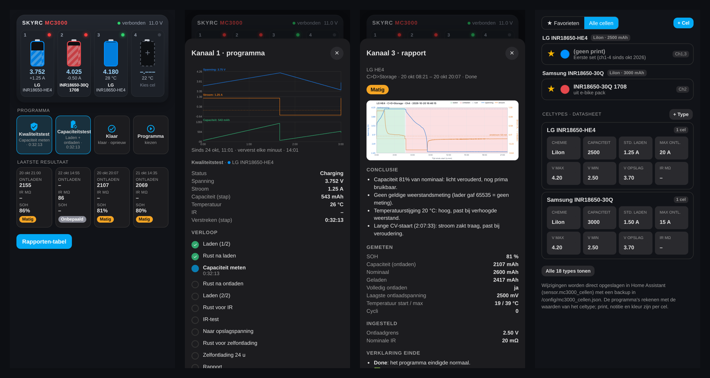
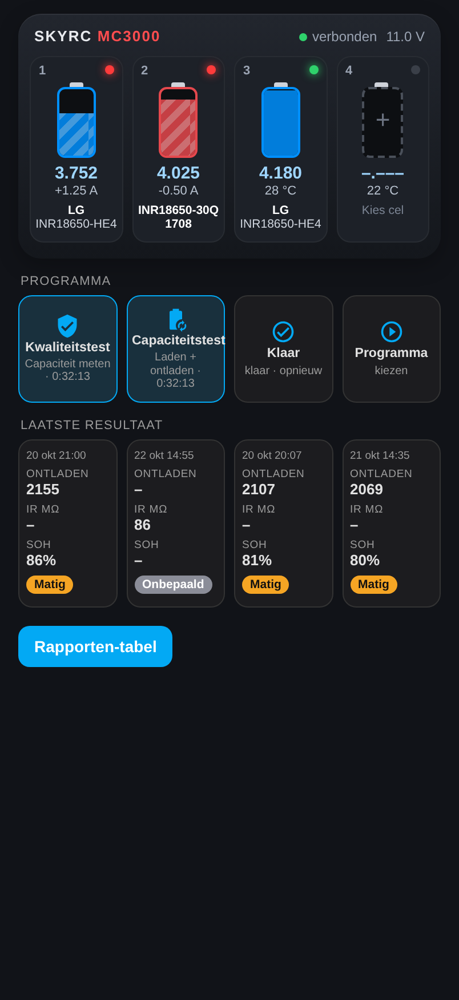
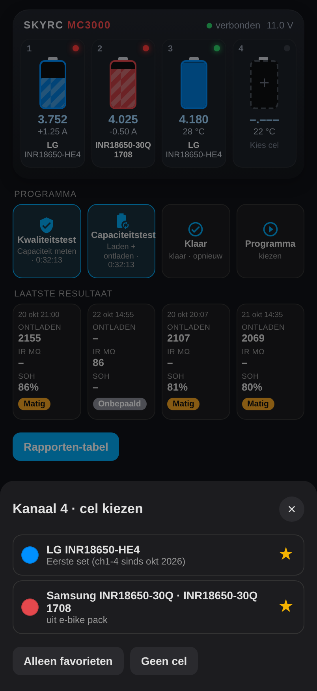
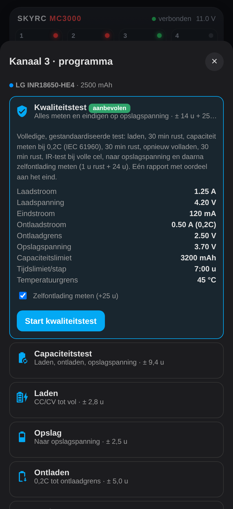
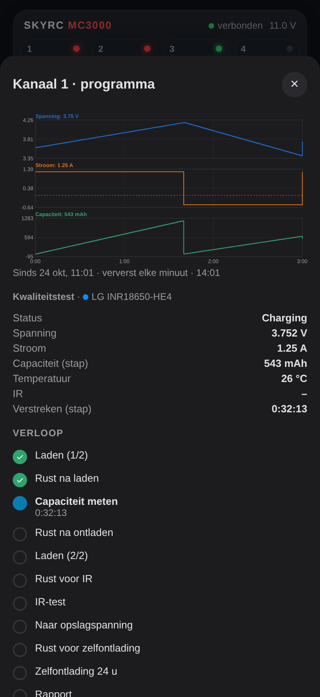
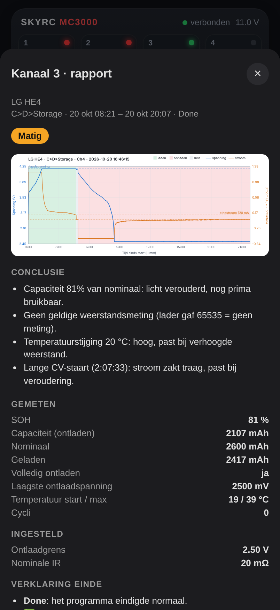
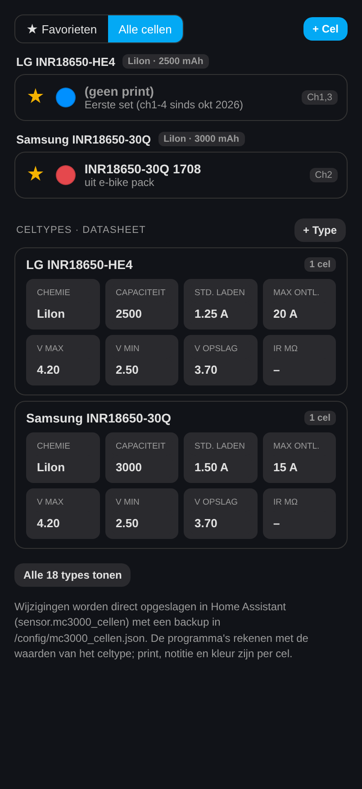
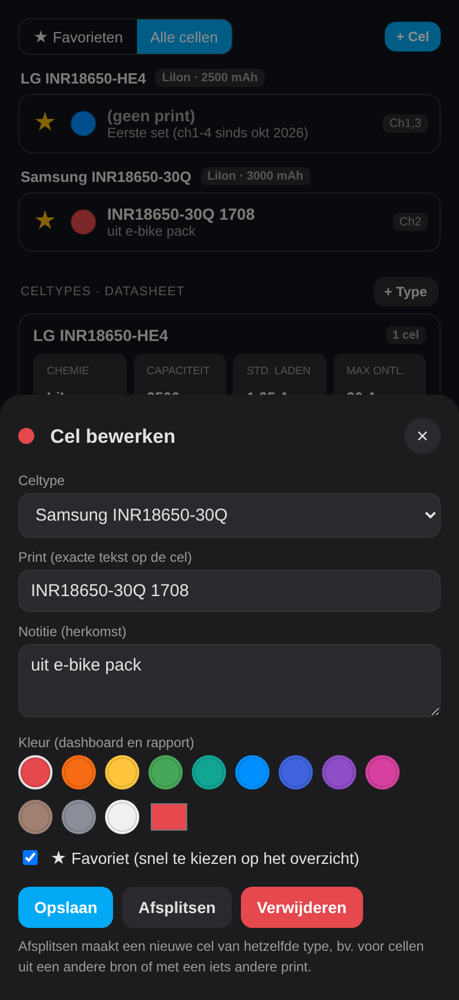
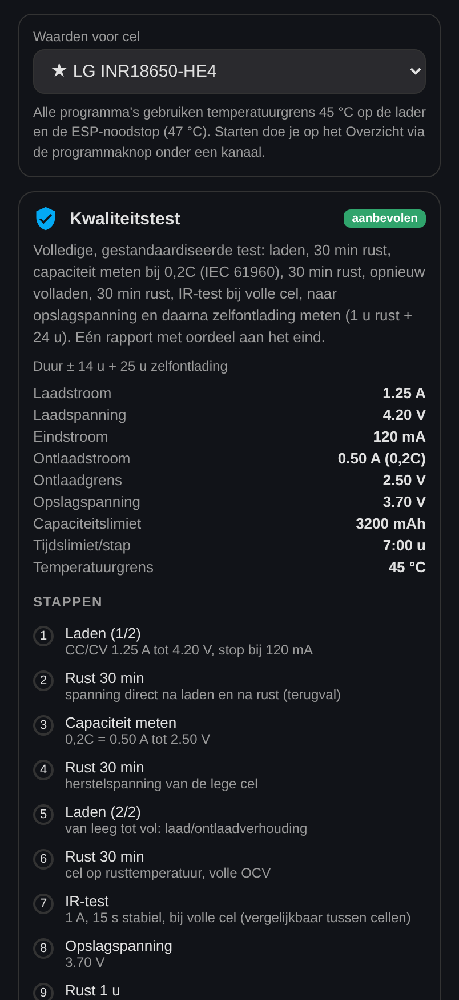

# SkyRC MC3000 × Home Assistant

Run the **SkyRC MC3000** battery charger/analyser from Home Assistant instead of the phone app: an ESP32-C6 talks
Bluetooth LE to the charger, ESPHome exposes every channel to HA, and a custom dashboard card turns it into a
battery lab: a cell database, a one-tap **quality test** that measures everything and leaves the cell at storage
voltage, live charts and a report with a verdict for every test.



> The dashboard texts are in Dutch (the author's language); code, comments and this README are in English.

## What you get

- **Four slots, one screen.** The charger's front panel at phone width: cell colour, charge level, voltage, current,
  temperature and the status LED per channel. Below each slot the program button and the last finished result
  (capacity, internal resistance, state of health, verdict).
- **Cell database.** Cell *types* with their datasheet defaults (chemistry, capacity, standard charge current, max
  discharge, charge / cut-off / storage voltage, IR) and the physical *cells*: type + the exact print on the wrap +
  a note on where they came from + a colour + a favourite star. Cells from different sources stay apart even when
  they are the same type.
- **Programs that know the cell.** Pick a cell, pick a program, start. Currents, voltages, end current, capacity
  and time limits follow from the cell type (charge = min(standard, 0.5C, 2 A), discharge 0.2C, end current C/20).
- **Quality test**, fully automatic: charge → 30 min rest → capacity at 0.2C (IEC 61960 style) → 30 min rest →
  recharge → 30 min rest → IR test at full charge → storage voltage → self-discharge over 24 h → one report.
  Faults are handled instead of just stopping: cool down and resume with less current after a temperature fault,
  pause and resume after a time limit, no more charging after *capacity protection* (suspect cell) but still the
  self-discharge test, abort with an explanation on a short or a removed cell.
- **Live chart** of voltage, current and capacity since the start of the running program.
- **Reports** for every finished test, published as GitHub releases (chart, measured and set values, verdict and
  an explanation of *why* a test ended, e.g. which condition triggered a *time protection* fault), plus an
  overview table in HA.

| | | |
|---|---|---|
|  |  |  |
| Overview | Pick a favourite cell | Start a program |
|  |  |  |
| Running program, live chart | Report pop-up | Cell database |
|  |  | |
| Edit a cell | All programs and their settings | |

## How it fits together

```
 SkyRC MC3000  ──BLE──  ESP32-C6 (ESPHome, esphome/)  ──API──  Home Assistant
                                                                 ├─ ha/packages/mc3000.yaml   helpers, scripts, test sequencer
                                                                 ├─ ha/custom_templates/      charger values per cell + program
                                                                 ├─ ha/www/mc3000-card.js     the dashboard card
                                                                 └─ tools/ha_report.py        reports -> GitHub releases
```

- `firmware/` – standalone PlatformIO firmware used to reverse-engineer and verify the BLE protocol (serial console).
- `esphome/` – the ESPHome external component (`components/mc3000`) and device config.
- `ha/` – everything Home Assistant needs, see [ha/README.md](ha/README.md).
- `tools/` – report generator (`ha_report.py`), reports overview page (`build_reports_page.py`).
- `docs/PROTOCOL.md` – the MC3000 BLE protocol as used here.

## Installation

### 1. ESP32 with ESPHome

You need an ESP32 with Bluetooth LE (developed on an ESP32-C6 DevKitC-1) within BLE range of the charger.

1. Copy `esphome/SkyRC-MC3000.yaml` to your ESPHome config and `esphome/secrets.yaml.example` to `secrets.yaml`;
   fill in Wi-Fi, an API key and the BLE MAC address of your MC3000.
2. The config pulls the component straight from this repository (`external_components`). Compile and flash.
3. Add the device in HA (Settings → Devices & services → ESPHome). Entities appear as
   `sensor.skyrc_mc3000_ch1_voltage`, `select.skyrc_mc3000_program_mode`, …

The ESP keeps a temperature emergency stop (default 47 °C) independent of HA.

### 2. Home Assistant

1. Copy the files:

   | From | To |
   |---|---|
   | `ha/packages/mc3000.yaml` | `/config/packages/mc3000.yaml` (packages must be enabled) |
   | `ha/custom_templates/mc3000.jinja` | `/config/custom_templates/mc3000.jinja` |
   | `ha/www/mc3000-card.js`, `ha/www/rapporten-live.html` | `/config/www/mc3000/` |
   | `tools/ha_report.py` | `/config/py_scripts/mc3000_report.py` |

2. In the package, change `notify.notify` to your phone (`notify.mobile_app_…`).
3. Add the dashboard resource `/local/mc3000/mc3000-card.js?v=1` (JavaScript module) and create a dashboard from
   [ha/dashboard.yaml](ha/dashboard.yaml).
4. Restart Home Assistant, then open the **Cellen** tab and add your cell types and cells.

### 3. Reports on GitHub (optional)

Test reports go to the releases of a GitHub repository of your choice (it can be private).

- `/config/secrets.yaml`: `mc3000_ha_token` (a long-lived HA token) and `mc3000_github_token` (a token with access
  to that repository).
- `/config/mc3000_settings.yaml`:
  ```yaml
  github_repo: your-user/your-reports-repo
  ha_url: https://your-home-assistant:8123   # optional, default: HA's own external/internal URL
  ```
- Copy `.github/workflows/reports-page.yml` and `tools/build_reports_page.py` into that repository; the workflow
  builds the overview table that HA pulls in hourly.

## Safety

Lithium cells store a lot of energy. This project drives a real charger: test it with cells you can afford to
lose, never leave a charging cell unattended in a place where a fire can spread, and keep the charger's own and
the ESP's temperature limits in place. The software comes without any warranty (see [LICENSE](LICENSE)).

## Credits

The BLE protocol builds on earlier community reverse-engineering of the MC3000, see
[docs/PROTOCOL.md](docs/PROTOCOL.md). SkyRC and MC3000 are trademarks of SkyRC Technology; this project is not
affiliated with SkyRC.
